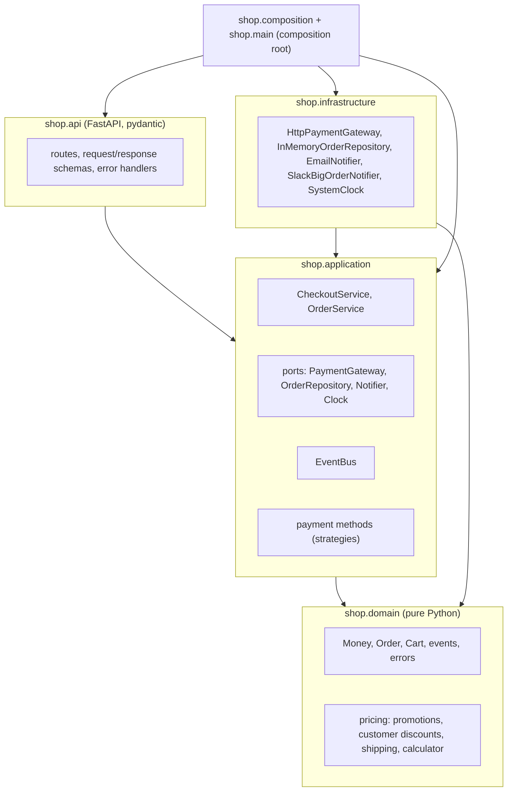
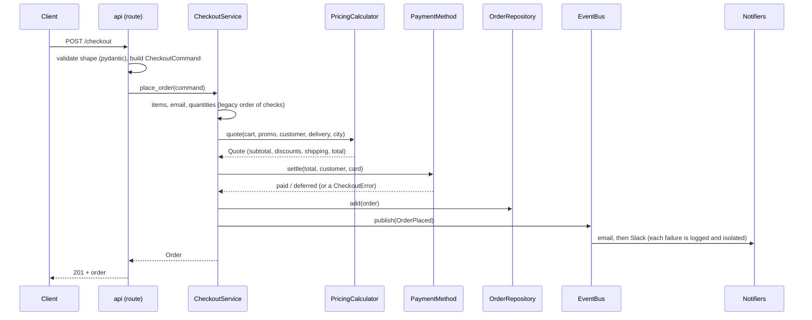

# Architecture

This module replaces a single 90-line legacy function (`legacy/checkout.py`) that validated input,
priced orders, charged cards, stored orders, wrote a log file and sent notifications in one place.
The refactoring keeps its observable behaviour (see [Legacy defects](#legacy-defects-fixed-and-kept)
for the deliberate exceptions) and makes the three things the business keeps changing, promo codes,
delivery methods and payment methods, additive.

- [Layers](#layers)
- [Checkout flow](#checkout-flow)
- [Key decisions](#key-decisions)
- [Patterns and the problem each one solves](#patterns-and-the-problem-each-one-solves)
- [Where patterns were deliberately not applied](#where-patterns-were-deliberately-not-applied)
- [Legacy defects: fixed and kept](#legacy-defects-fixed-and-kept)
- [Known limitations](#known-limitations)

## Layers

The dependency rule: arrows point inwards, and nothing in an inner layer names an outer one.

| Package | Contains | May import |
|---|---|---|
| `shop.domain` | Value objects, the `Order` aggregate, pricing rules, domain events and errors | the standard library only |
| `shop.application` | Use cases (`CheckoutService`, `OrderService`), ports, the event bus, payment methods | `shop.domain` |
| `shop.infrastructure` | Adapters that implement ports: HTTP, storage, clock | `shop.domain`, `httpx` |
| `shop.api` | FastAPI app, pydantic schemas, error translation | `shop.application`, `shop.domain`, `fastapi`, `pydantic` |
| `shop.composition`, `shop.main` | Wiring | everything |

The rule is enforced, not just documented: `import-linter` contracts in `pyproject.toml` run in CI and
fail the build if `shop.domain` imports `shop.application`, `shop.infrastructure`, `shop.api`,
`fastapi`, `httpx`, `pydantic` or `requests`, or if `shop.application` imports an adapter or a framework.

## Checkout flow

Pricing is a contract inherited from the legacy code, and each step rounds to a whole kopiyk:

1. subtotal of all lines,
2. promo code (a discount and/or free shipping),
3. customer-segment discount (VIP, 5%),
4. shipping, based on the total **after** steps 2 and 3, skipped when the promo waives it.

## Key decisions

### Money: integer kopiyky, one rounding rule

`Money` is a frozen dataclass holding an `int` number of kopiyky. The alternative, `Decimal` with
fixed precision, would work as well; integers were chosen because addition, comparison and equality
are exact by construction and there is no context or precision setting that can be misconfigured.

Fractions of a kopiyk can only appear when multiplying by a rate (`Money.scale`). That is the single
place where rounding happens, with `ROUND_HALF_UP` on an exact `Decimal`: 0.5 kopiyky becomes 1.
Python's `round()` is not used: on floats it is subject to binary representation
(`round(0.125, 2) == 0.12`) and on exact values it rounds half to even.
Floats are rejected by the whole `Money` API, so they cannot slip in unnoticed.
The rule is covered by tests in `tests/unit/domain/test_money.py`.

Chained discounts round after each step (`Money.scale` is applied per step), so the order of steps is
part of the observable result. The unit tests pin both the order and the per-step rounding.

### Errors: exceptions, not a `Result` type

Business rule violations are exceptions deriving from `DomainError`, each with a stable `code`
(`no_items`, `cod_limit`, ...). Exceptions are the idiomatic Python mechanism, keep the happy path in
`CheckoutService` linear, and let the HTTP layer translate by type in one place (`shop/api/errors.py`).
A `Result` type would force every caller up the stack to unwrap values and would add a second error
channel next to the exceptions that the standard library and `httpx` already raise.
Callers branch on the type or the `code`, never on the message.

### `Protocol` rather than abstract base classes

Ports and strategy interfaces are `typing.Protocol` classes. They are structural: an adapter or a
strategy conforms by having the right methods, without inheriting from anything, so the infrastructure
package does not import application ports, and a test double is just a class with two methods.
`mypy --strict` checks conformance at the point where the object is wired in. ABCs would add an
inheritance edge for every implementation without adding safety, and none of the interfaces share
implementation.

### Domain objects are dataclasses, not pydantic models

Pydantic validates untrusted input at the boundary; the domain is internally consistent by construction
(`Money` cannot be negative, `Cart` cannot be empty, `Order.status` cannot be assigned). Keeping pydantic
out of `shop.domain` is enforced by an import contract and keeps the domain testable without a framework.

### Events carry facts, the aggregate buffers them

`Order.place` and `Order.cancel` record events on the aggregate; the use case publishes them with
`pull_events()` **after** the order is stored. A subscriber can therefore never observe an order that
does not exist yet, and a failed state transition records nothing.

## Patterns and the problem each one solves

| Pattern | Where | Problem in the legacy code it removes |
|---|---|---|
| **Value Object** | `Money`, `EmailAddress`, `CardToken`, `OrderLine`, `Cart` | `float` money with binary tails (`SALE10` on 99.99 gave 89.991), free-form `dict` items, a card token one `print()` away from a log (`CardToken.__repr__` is masked). |
| **State machine** | `Order` (`OrderStatus` + one transition table) | `change_status` accepted any string, so `delivered -> new` and `"banana"` were valid. Now only the documented transitions exist, and only through `pay/ship/deliver/cancel`. |
| **Strategy + registry** | promotions, customer discounts, shipping methods (`shop.domain.pricing`), payment methods (`shop.application.payment_methods`) | Every new promo code or delivery method meant editing the same `if/elif` chain in `checkout()`. Now a rule is a small object plus one registry entry; `PricingCalculator` and `CheckoutService` do not change. See [BUY3 and pickup](README.md#proving-the-design-is-open-for-extension). |
| **Ports and adapters (Dependency Inversion)** | `PaymentGateway`, `OrderRepository`, `Notifier`, `Clock` | Business logic called `requests.post` and `open()` directly and kept `orders` / `last_id` in module globals. It could not be tested without patching the world, and it lost data on restart. |
| **Observer / domain events** | `EventBus`, `OrderPlaced`, `RefundRequested` | Notification code was inline in the checkout, duplicated per customer type, and a mail failure turned a paid, created order into an HTTP 500 (inviting a retry and a double charge). Subscribers are isolated: a failing one is logged and the others still run. |
| **Composition root** | `shop/composition.py` | Wiring is in one place; nothing else constructs adapters. |
| **Exception hierarchy** | `shop.domain.errors` | Errors were `{"ok": False, "msg": "..."}` strings. |

Configuration that used to be hard-coded is now injected at the composition root: the Slack threshold
(`Settings.big_order_threshold`), the cash-on-delivery limit (`Settings.cod_limit`), the email template
per customer segment, all URLs and timeouts.

## Where patterns were deliberately not applied

| Candidate | Why not |
|---|---|
| **Abstract Factory / Factory classes** for strategies or orders | There is one family of products and construction is trivial. A registry `dict` and a `classmethod` (`Order.place`) are enough. |
| **Builder** for `Order` | The aggregate has six fields, all required. Keyword-only arguments already read like a builder. |
| **Chain of Responsibility / pipeline** for the pricing steps | There are exactly four steps in a fixed, contractual order. A chain would hide that order behind configuration and invite reordering, which changes totals. `PricingCalculator.quote` reads top to bottom and is the single place that knows the order. |
| **Specification pattern** for validation | Four checks with a defined precedence. Plain code in `CheckoutService` and `Cart.of` is shorter and the precedence is visible. |
| **Strategy for the email template** | The template is a dictionary lookup from customer segment. A class per template would be ceremony. |
| **`match` replaced by Strategy in `OrderService.change_status`** | Four stable targets mapped one-to-one to aggregate methods, driven by a closed `Enum`. `match` is the right tool here: the set does not grow by configuration and mypy checks the cases. Strategy is used where the set of variants is open (promo codes, delivery, payment), `match` where it is closed. |
| **Unit of Work / transaction abstraction** | The only store is in memory. Adding a UoW now would be an abstraction over nothing; it belongs with a real database adapter. |
| **DI container** (`dependency-injector`, `punq`) | About twenty objects wired in forty lines. FastAPI's `Depends` is used at the HTTP layer only, to hand services to routes. |
| **CQRS, message broker, outbox** | The workload does not call for them. The event bus is in-process on purpose; the outbox is the next step if delivery guarantees become a requirement (see limitations). |
| **A generic `Result[T, E]`** | See [Errors](#errors-exceptions-not-a-result-type). |

## Legacy defects: fixed and kept

IDs refer to [`docs/CODE_REVIEW.md`](docs/CODE_REVIEW.md). Every fixed defect is covered by a test; kept
behaviour is pinned by the characterization suite so that changing it is a visible, deliberate act.

### Fixed

| ID | Fix | Evidence |
|---|---|---|
| C1 | `Money` in kopiyky, one rounding rule. Totals no longer have float tails and match the legacy value rounded half up. | `tests/unit/domain/test_money.py`, golden case `sale10-keeps-a-float-tail-rounded-half-up` |
| C3 | Notification failures are isolated by the event bus and logged. | `tests/unit/application/test_checkout_service.py::TestEvents`, `tests/integration/test_api.py` |
| C4 | Unsupported or missing payment methods are rejected (`unsupported_payment`). Separate `fix:` commit. | `DIVERGENCES` in `tests/characterization/cases.py` |
| C5 | Shape validated by pydantic (strict integer `qty`, non-negative price with at most two decimals); domain rejects non-positive quantities. A missing `qty`/`price` is a 422, not a `KeyError`. | `tests/integration/test_api.py::TestRejections` |
| C6 | `Order` state machine. | `tests/unit/domain/test_order.py` |
| C10 | Timezone-aware UTC timestamps from an injectable `Clock`. | `tests/unit/domain/test_order.py` |
| S1, S2 | A client-supplied `free_ship` has no effect: only a promotion can waive shipping. Pricing never mutates its input. | `tests/integration/test_api.py::test_a_client_cannot_grant_itself_free_shipping` |
| S3 | No log file. Log lines refer to order ids and never contain the email or the card. | `tests/unit/application/test_checkout_service.py::TestCardSecrecy` |
| S4 | The card is a masked `CardToken`, goes to the gateway only, and is stripped from validation error bodies. | `tests/integration/test_api.py::test_validation_errors_do_not_echo_the_input` |
| S5, R1 | All HTTP calls have timeouts. A payment outage (5xx, unreadable body, network error) is a distinct `payment_unavailable` error (HTTP 502), not a decline and not a crash. | `tests/unit/infrastructure/test_payments.py` |
| R2 | No module globals; id allocation is thread-safe. State lives behind `OrderRepository`. | `tests/unit/infrastructure/test_repository.py` |
| R3, R4 | `logging` instead of `print`; no blocking file I/O on the request path. | n/a |

Two further changes come with the typed API rather than with a separate commit: a card payment without
a card token is rejected with `card_required` (legacy sent `null` to the provider), and prices with
more than two decimals are rejected (legacy accepted them and sent fractions of a kopiyk onward).

### Kept on purpose

| ID | Behaviour | Why it was kept |
|---|---|---|
| C7 | Unknown promo codes and unknown customer types are ignored. | Defensible as a product decision (a stale code must not block a purchase). Now explicit and tested. Rejecting unknown codes would be a one-line change in `PricingCalculator`, if the business wants feedback to the customer. |
| C8 | The free Nova Poshta threshold is checked against the total after promo and VIP discounts. | A business rule, not an obvious bug. Documented and pinned by golden cases `nova-threshold-is-checked-after-promo` and `...-after-vip`. |
| C9 | `FREESHIP` waives shipping without validating the delivery method. | Same as above; pinned by `freeship-skips-delivery-validation`. |
| - | A missing city counts as "not Kyiv" for courier delivery; city comparison is case-sensitive. | Preserves legacy totals; pinned by golden cases. |
| - | The cash-on-delivery limit is checked against the final total including shipping. | Preserves legacy behaviour. |

## Known limitations

- **C2: the card is charged before the order is stored.** If storing the order fails after a successful
  charge, the customer has paid for nothing. With an in-memory repository the window is tiny, but with
  a real database it matters. The remedy is outside this scope: an idempotency key sent to the payment
  provider plus a compensating refund, or an outbox. The `RefundRequested` event is the hook a refund
  worker would subscribe to.
- **Refunds are requested, not executed.** Cancelling a paid order publishes `RefundRequested`; the only
  subscriber logs it.
- **Cash-on-delivery and invoice orders start as `new` and the state machine only allows `new -> paid`
  or `new -> cancelled`.** Shipping such an order requires marking it `paid` first. That is what the
  specified transition table says; a product decision (for example allowing `new -> shipped` for
  deferred-payment methods) is needed to change it.
- **The repository is in memory.** It is not shared between worker processes, so a multi-worker
  deployment needs a persistent `OrderRepository` adapter. The domain and services need no change.
- **Notifications are best-effort.** A failed email is logged and not retried.
